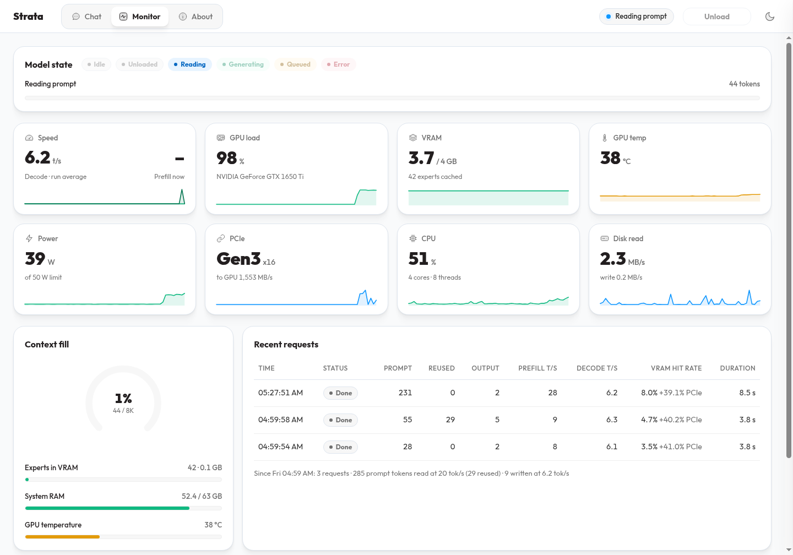
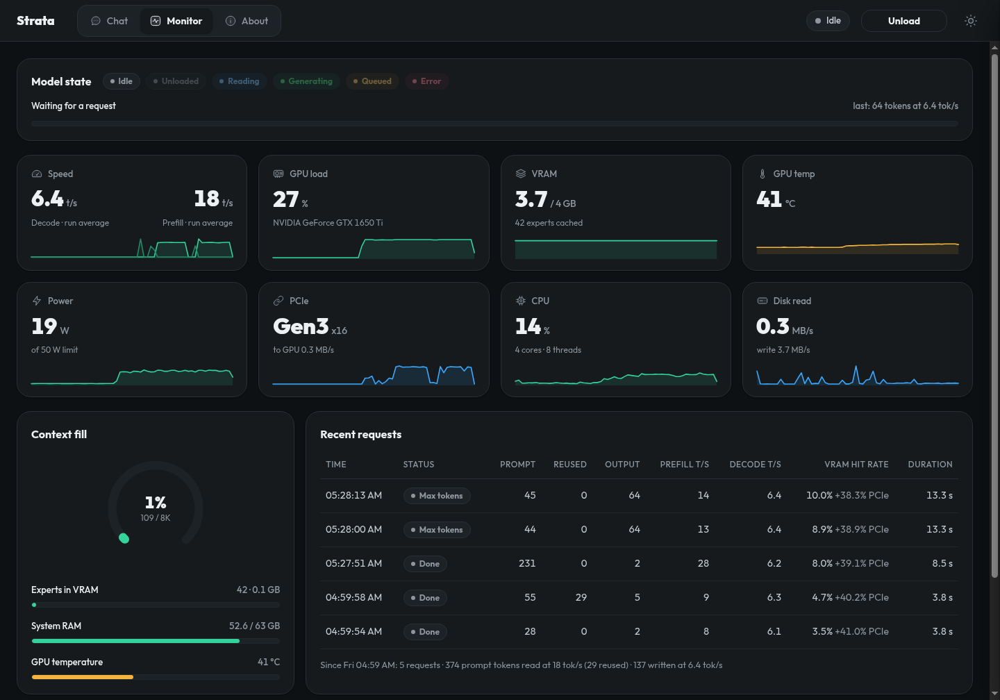
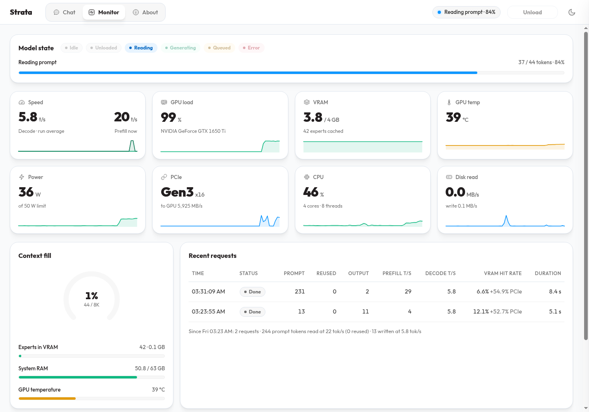
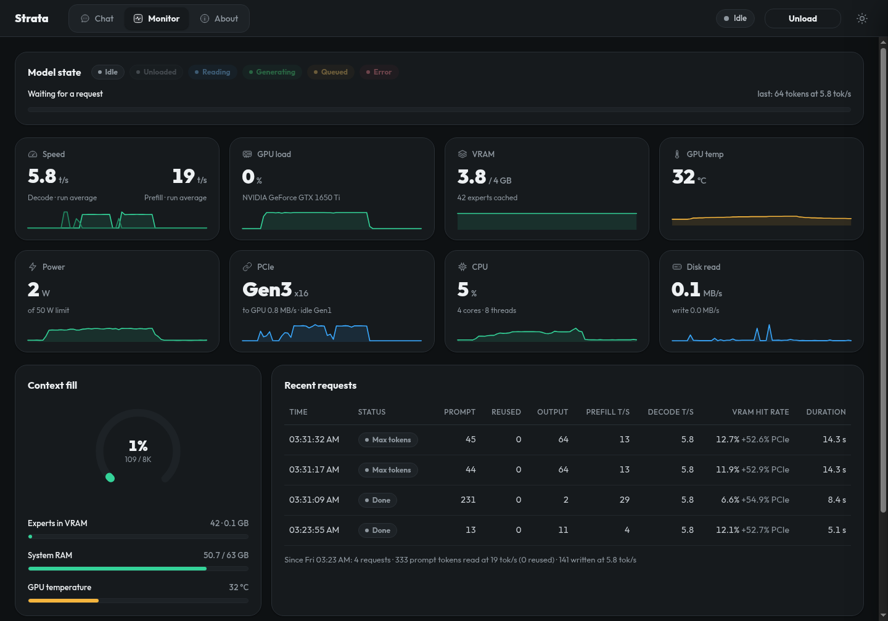

# Strata — GTX 1650 Ti · 4GB VRAM

**تشغيل تجريبي محلي لـ Qwen3.8-Flash-Next على لابتوب بكرت GTX 1650 Ti بذاكرة 4GB.**

هذه نسخة غير رسمية من [Niko1221/Strata](https://github.com/Niko1221/Strata)، تركّز على تجاوز ضيق ذاكرة الكرت وتحسين الأداء على جهاز اختُبر فعليًا، بدل نقل إعدادات كروت أكبر دون قياس.

> **4GB هنا هي ذاكرة الكرت، وليست RAM الجهاز.** الاختبارات أُجريت على Linux مع **64GB RAM** ومعالج **Intel Core i5-10300H**. لا تعني النتائج أن الموديل سيعمل على جهاز بذاكرة نظام صغيرة.

[النتائج](#performance) · [صور التشغيل](#monitor-screenshots) · [البناء والتشغيل](#build-and-run) · [الحدود](#limits) · [الدليل بالإنجليزية](docs/GTX1650.md)

## آخر التطورات — 14 نوفمبر 2026

- **جولة ثالثة: `hc-q8-decode` وصل إلى 15.5 بالإنجليزية و15.4 بالعربية توكن/ث**، بوسيط ثلاث جولات. أبقى رأس الإخراج على الكرت واستغنى عن مخازن القراءة المجمّعة للنص. **قراءة النص الطويل أبطأ وهامش VRAM أصغر**؛ إنه خيار منفصل، لا إعداد افتراضي ولا تحسين لكل الطلبات.
- **نجح تحميل الموديل وتشغيله على الكرت ذي 4GB:** أُضيف خيار `STRATA_WEIGHT_ARENA_HOST=1` لوضع ساحة الأوزان الأساسية في RAM مثبّتة، مع وصول الكرت إليها عبر PCIe.
- **أُضيف إعداد `fast` اختياري:** يحتفظ برأس الإخراج في VRAM عندما يتّسع، ويفعّل تحسينات Turing الموجودة في المحرك، ويزيد دفعة قراءة النص من 32 إلى 256، ويستخدم المسار الدفعي للرسائل القصيرة.
- **أُضيف `cached` دون تكميم إضافي:** يستخدم مسبح تخصيص CUDA ويحتفظ بنحو 160MiB من الأوزان في VRAM بنفس بايتاتها؛ رفع التوليد إلى **6.3 توكن/ث**.
- **أُضيف `hc-q8` كتجربة منفصلة تغيّر دقة HC:** بلغ **8.8 توكن/ث** مع سياق 8K، لكنه ليس مقارنة متكافئة في الجودة ولا الخيار الافتراضي.
- **الإعداد الأصلي `stable` ما زال الافتراضي، ولم تتغيّر إعدادات `fast`.** لكل إعداد ملف تشغيل وسجل منفصلان. لا يستبدل المشغّل إعدادات تطبيق Strata أو محركاته المثبتة.
- **قياسات قابلة للمراجعة:** ثلاث جولات لكل إعداد، مع حفظ الطلبات والإجابات والأزمنة. جُرّبت إعدادات أخرى، ووُثّقت المحاولات الفاشلة والمرفوضة أيضًا.
- **فحوص فعلية:** نجح كل إعداد جديد في 11 فحصًا صغيرًا، منها عربي وJSON وبرمجة بسيطة ونداء أداة واستخدام نتيجتها، واسترجاع معلومة من **8,169 توكن إدخال**. نجحت أيضًا محادثة متابعة مع إعادة استخدام النص.

لا يتضمن هذا المستودع أوزان الموديل أو محركًا مبنيًا مسبقًا. **مثبّتات المشروع الأصلي لا تحتوي تعديل هذه النسخة**؛ يلزم البناء من المصدر واستخدام ملفات موديل مجهّزة مسبقًا.

<a id="performance"></a>

## نتائج الأداء

### البناء الثالث — أولوية التوليد، مع توضيح المقابل

قياس جديد في **14 نوفمبر 2026، بنفس ملف المحرك النهائي لكلا الإعدادين**، ثلاث جولات لكل إعداد، دون إعادة استخدام النص. النموذج نفسه، والسياق **8K / int8 KV**، وتكميم **HC Q8 نفسه في العمودين**:

| القياس | `hc-q8` — أُعيد قياسه اليوم | `hc-q8-decode` — الجديد ⚠️ |
| --- | ---: | ---: |
| توليد الشرح بالإنجليزية | 9.2 توكن/ث | **15.5 توكن/ث** |
| توليد الشرح بالعربية | 9.2 توكن/ث | **15.4 توكن/ث** |
| زمن طلب الشرح الإنجليزي | 8.76 ثانية | **6.04 ثانية** |
| زمن طلب الشرح العربي | 8.73 ثانية | **6.08 ثانية** |
| قراءة النص ذي 231 توكن | **33.8 توكن/ث** | 22.2 توكن/ث |
| الزمن الكامل لطلب النص نفسه | **7.05 ثانية** | 10.53 ثانية |
| VRAM الفارغة بعد التحميل | **277MiB** | 149MiB — تحذير LOW |

تحسن التوليد بنحو **68%** عن خط أساس اليوم، وليس عن قراءة النص. لا يوجد تنزيل جديد ولا تكميم إضافي فوق `hc-q8`، لكن طريقة قراءة النص وترتيب الحسابات يتغيران. **ليس إثباتًا لتكافؤ جودة الإجابات.** تُقرأ المدخلات عبر نوافذ التحقق بدل المسار المجمّع، فيتّسع رأس الإخراج وذاكرة أوزان مؤقتة على الكرت. ضُبط توزيع العمل عبر PCIe على `0.5` بعد التجربة.

**149MiB هامش صغير** وتستهلك الرسوم الملتقطة ذاكرة إضافية. استخدمه للدردشة النصية حين تهمك سرعة الإجابة أكثر من قراءة المستندات الطويلة. ارجع إلى `hc-q8` أو `cached` إن لم يتّسع أو كانت سرعة قراءة النص أهم. لم تتغير الإعدادات الأربعة القديمة أو الافتراضي `stable`.

**[بيانات البناء الثالث: الجولات الخام، والمحاولات التي لم تنجح، والفحوص والحدود](bench/results/2026-11-14-gtx1650ti-4gb-decode-residency/README.md)**

### البناء الأول والبناء الثاني — مقارنة مجمّعة

**نفس الجهاز وملفات الموديل والطلبات، 3 جولات لكل إعداد، والتفكير معطّل.** البناء الأول هو المحرك الذي شغّل الأوزان من RAM مع تحسين `fast` الأول. البناء الثاني يضيف تخصيص الأوزان المجمّع وذاكرة الأوزان المؤقتة، مع خيار HC Q8 منفصل:

| القياس | البناء الأول — `stable` | البناء الأول — `fast` | البناء الثاني — `cached` | البناء الثاني — `hc-q8` ⚠️ |
| --- | ---: | ---: | ---: | ---: |
| توليد الشرح بالإنجليزية | 4.9 توكن/ث | 5.8 توكن/ث | **6.3 توكن/ث** | **8.8 توكن/ث** |
| توليد الشرح بالعربية | 4.9 توكن/ث | 5.8 توكن/ث | **6.3 توكن/ث** | **8.8 توكن/ث** |
| زمن طلب الشرح الإنجليزي | 18.03 ثانية | 12.87 ثانية | **12.12 ثانية** | **9.13 ثانية** |
| زمن طلب الشرح العربي | 18.10 ثانية | 12.84 ثانية | **12.09 ثانية** | **9.09 ثانية** |
| قراءة النص ذي 231 توكن | 14.4 توكن/ث | 35.6 توكن/ث | 35.8 توكن/ث | 33.8 توكن/ث |
| الزمن الكامل لطلب النص نفسه | 16.41 ثانية | 6.83 ثانية | 6.78 ثانية | 7.06 ثانية |
| VRAM الفارغة بعد التحميل | 744MiB | 256MiB | 274MiB | 276MiB |
| السياق / KV | 8K / `int8` | 8K / `int8` | 8K / `int8` | 8K / `int8` |
| تكميم HC إضافي | لا | لا | لا | **نعم — Q8_0** |

هذا جدول لتتبّع التطور بين بنائين، **وليس مقارنة متزامنة بنفس ملف المحرك في الأعمدة الأربعة**. أرقام البناء الأول من التقرير الأول، وأرقام البناء الثاني من التقرير الثاني. لم تُخلط الجولات أو تُحسب وسائط جديدة بينهما. `hc-q8` يغيّر دقة HC وإعدادات أخرى، فلا يُعد مقارنة متكافئة في الجودة. قيم الذاكرة لقطات بعد التحميل، وليست ذروة الاستهلاك.

### ظروف القياس المشتركة

- **الجهاز:** NVIDIA GeForce GTX 1650 Ti 4GB، معالج i5-10300H، و64GB RAM.
- **النظام:** Linux، تعريف NVIDIA `620.70.06`، وCUDA `13.4.92`.
- **الموديل:** ISTA-DASLab Qwen3.8-Flash-Next GSQ-RCO **IQ3_XXS**، بنفس الملفين ونفس الحزمة المجهّزة.
- **المحرك:** كلاهما بناء محلي `0.1.59.1`، لكن الملفين مختلفان. بصمة SHA256 للبناء الأول تبدأ بـ `4fbe3ea2702a`، وللثاني بـ `87af0e9e6239`. البصمتان الكاملتان ونسخ المصدر موثقتان في تقريري القياس أدناه.
- **الإعدادات المشتركة:** سياق 8,192 توكن، KV من نوع `int8`، ثلاثة عمّال CPU، دون صور أو موديل مسودة، وحرارة توليد `0`.
- الأرقام هي **وسيط الجولات الثلاث**. أُوقف تخزين نقاط استعادة النص في جميع إعدادات المقارنة بـ `--prompt-cache 0`؛ عدد توكنات النص المعاد استخدامها كان صفرًا.
- قياس التوليد مأخوذ من طلبي شرح، أحدهما بالإنجليزية والآخر بالعربية، بحد **64 توكن للإجابة**. طلب 231 توكن أعاد `Paris` في توكنين، فلا يُستخدم وحده لتقييم التوليد المستمر.
- زمن تحميل الموديل غير محسوب. **زمن أول توكن لم يُقَس في جولات القياس**؛ الزمن الكامل يشمل الطلب حتى اكتمال الإجابة.

هذه مقارنة إعدادات على جهاز واحد، وليست مقارنة مع إصدار رسمي أحدث أو ضمانًا لأداء كل المحادثات.

**[بيانات البناء الأول: الجولات والإعدادات والسجلات والمحاولات المرفوضة](bench/results/2026-11-13-gtx1650ti-4gb-tuning/README.md)**

### تفصيل البناء الثاني — مع إعادة قياس `fast`

للمقارنة داخل **ملف المحرك الجديد نفسه**، أُعيد قياس `fast` إلى جانب `cached` و`hc-q8`، بثلاث جولات لكل إعداد. هذا يوضح خط الأساس المستخدم لحساب تحسن 7% و49% أدناه، بدل الخلط مع 5.8 توكن/ث المسجلة في البناء الأول. أُوقف تخزين نقاط الاستعادة في الجميع، ولم يُعَد استخدام أي توكن من النص:

| القياس | `fast` — خط أساس جديد | `cached` — دون تكميم إضافي | `hc-q8` — **يغيّر دقة HC** |
| --- | ---: | ---: | ---: |
| توليد الشرح بالإنجليزية | 5.9 توكن/ث | **6.3 توكن/ث** | **8.8 توكن/ث** |
| توليد الشرح بالعربية | 5.9 توكن/ث | **6.3 توكن/ث** | **8.8 توكن/ث** |
| زمن طلب الشرح الإنجليزي | 12.74 ثانية | **12.12 ثانية** | **9.13 ثانية** |
| قراءة النص ذي 231 توكن | 35.4 توكن/ث | 35.8 توكن/ث | 33.8 توكن/ث |
| VRAM الفارغة بعد التحميل | 256MiB | 274MiB | 276MiB |
| السياق / KV | 8K / `int8` | 8K / `int8` | 8K / `int8` |

تحسن التوليد في `cached` بنحو **7%**، دون تغيير بايتات الأوزان المنسوخة. قراءة النص لم تتغير عمليًا. إعادة قياس المحرك السابق أعطت 5.8–5.9 توكن/ث؛ فرق الأعشار بين الجولات ليس ادعاءً بتحسن الإعداد الافتراضي.

`hc-q8` أسرع في التوليد بنحو **49%** من خط الأساس الجديد، لكنه يعيد تكميم أوزان HC ويغيّر موضع الرأس وحجم مخزن الخبراء ودفعة القراءة. **ليس إثباتًا لعدم تراجع الجودة، وكان أبطأ في قراءة النص الأطول.** يبقى خيارًا تجريبيًا منفصلًا. أرقام الذاكرة لقطات بعد التحميل، وليست ذروة الاستهلاك.

**[بيانات البناء الثاني: القياسات والفحوص والدروس من مراجعة basalt وllamAmpere](bench/results/2026-11-13-gtx1650ti-4gb-pool-cache/README.md)**

<a id="monitor-screenshots"></a>

## صور فعلية من المراقبة

لقطات فعلية من السيرفر المحلي على [`http://127.0.0.1:8080/#monitor`](http://127.0.0.1:8080/#monitor)، بتاريخ 13 نوفمبر 2026. صور البناء الثاني مرفقة أدناه، وصور البناء الأول محفوظة للمقارنة.

### البناء الثاني — `cached` أثناء قراءة طلب



### البناء الثاني — `cached` بعد اكتمال الطلبات



هذه اللقطات من **`cached` دون تكميم HC إضافي، وليست من `hc-q8`**. تظهر 6.4 توكن/ث لطلبي الشرح في هذه الجلسة، بينما وسيط جولات القياس المنشورة هو **6.3 توكن/ث**. لم تُعدّل الأرقام، ولم تتغير نتائج جدول الأداء. تخزين نقاط الاستعادة مفعّل هنا، والعدّادات لحظية أو متوسطات جلسة، وليست جولات قياس إضافية. [وقت الالتقاط والشروط والطلبات الفعلية](docs/media/gtx1650/README.md).

<details>
<summary>صور البناء الأول — إعداد fast، للمقارنة التاريخية</summary>

التُقطت الصورتان التاليتان أثناء تشغيل `fast` في البناء الأول.

### أثناء قراءة طلب



تظهر حالة القراءة، وكرت GTX 1650 Ti، واستخدام VRAM وRAM، ونشاط النقل عبر PCIe.

### سجل الطلبات — الوضع الداكن



تظهر طلبات فعلية وسرعة التوليد واستهلاك الذاكرة. حالة `Max tokens` تعني أن الإجابة وصلت إلى حد 64 توكن المحدد للتجربة، لا أن الطلب فشل.

> **الصور ليست جولات القياس الثلاث في الجدول.** إنها لقطات تشغيل عادي مع تخزين نقاط استعادة النص بإعداده الافتراضي، بينما عُطّل في مقارنة الأداء. العدّادات لحظية أو متوسطات جلسة، وقد تختلف عن وسيط القياسات. لم تُستبدل الأرقام الظاهرة بأرقام الجدول. [تفاصيل اللقطات](docs/media/gtx1650/README.md).

</details>

<a id="how-does-it-work"></a>

## ما الذي تغيّر تقنيًا؟

### تجاوز ضيق VRAM

في الاختبار الأصلي، لم يكفِ تقليل السياق وحده: الأوزان الأساسية والإسقاطات الأصلية استهلكت معظم VRAM قبل تخصيص حالة الجلسة.

الخيار الجديد `STRATA_WEIGHT_ARENA_HOST=1` يستخدم RAM مثبّتة ومُعيّنة للكرت لتخزين ساحة الأوزان الأساسية. هذا التعديل **لا يعيد تكميم تلك الأوزان**، لكن قراءتها عبر PCIe لها تكلفة زمنية. تبقى الإسقاطات ومخازن العمل وذاكرة الخبراء بحاجة إلى VRAM.

هذا المسار مخصص **لكرت CUDA منفصل واحد**، وهو معطّل ما لم تُضبط القيمة على `1`. ليس دعمًا عامًا لكل كروت GTX أو لكل الخلفيات.

### الفرق بين الإعدادين الأصليين

| الخاصية | `stable` — الافتراضي | `fast` — اختياري |
| --- | --- | --- |
| ساحة الأوزان الأساسية | RAM مثبّتة ومُعيّنة للكرت | نفسها |
| رأس الإخراج | يُفرض وضعه في RAM | يبقى على الكرت عندما يتّسع، مع إمكانية رجوع المحرك إلى RAM عند فشل التخصيص |
| تحسينات Turing | لا يفعّلها المشغّل صراحةً | `STRATA_SM75_PERF=1` |
| دفعة قراءة النص | 32 | 256 |
| الرسائل القصيرة | السلوك الأصلي للمحرك | المسار الدفعي عبر `--short-read 0` |
| السياق / KV | 8K / `int8` | 8K / `int8` |
| VRAM الفارغة بعد التحميل في الاختبار | 744MiB | 256MiB |
| ملف الإعداد | `gtx1650.json` | `gtx1650-fast.json` |
| سجل المحرك | `gtx1650.engine.log` | `gtx1650-fast.engine.log` |

قيم الذاكرة لقطات بعد التحميل، وليست ذروة الاستهلاك. إذا كان الكرت مشغولًا ببرامج أخرى ولم يتّسع `fast`، ارجع إلى `stable`.

لم يُفعّل `fast` تكميم HC إضافيًا، ولم يُقلّل السياق أو يغيّر دقة KV مقارنةً بـ `stable`. **هذا لا يثبت تطابق الإجابات بتًا ببت**؛ مسار قراءة النص وترتيب الحسابات يختلفان، وسياسات المحرك الأصلية لتجاوز بعض الخبراء ومشاركة CPU لم تتغيّر.

### الإعدادان الجديدان

- **`cached`:** يبدأ من `fast`، ويفعّل `STRATA_NATIVE_POOL=1` لتقليل هدر التخصيص، و`STRATA_WEIGHT_CACHE_MIB=160` لنسخ أوزان كاملة إلى VRAM قبل إنشاء الجلسات. نُسخ فعليًا **159.94MiB / 53 موترًا** دون إعادة تكميم. ملفاه `gtx1650-cached.json` و`gtx1650-cached.engine.log`.
- **`hc-q8`:** يفعّل المسبح و`STRATA_HC_Q8=1`، ويضع رأس الإخراج في RAM، ويستخدم `--expert-cache 8` ودفعة قراءة 128؛ عدد فتحات الخبراء الفعلي كان 10. **يغيّر دقة أوزان HC إلى Q8_0**، لا ملفات GGUF الأصلية. ملفاه `gtx1650-hc-q8.json` و`gtx1650-hc-q8.engine.log`.

لا يغيّر أي منهما سياق 8K أو دقة KV، ولا يثبت فحصهما القصير تكافؤ الجودة العامة. نجح تطابق بصمات 16 نافذة تشخيصية بين المحرك السابق والجديد عند تعطيل الخيارات، ومع `cached`؛ ذلك فحص محدد باستمرار مفروض وإعدادات ثابتة، وليس ضمان تطابق كل الإجابات.

<a id="build-and-run"></a>

## البناء والتشغيل

هذه خطوات المسار الذي اختُبر على **Linux**. تحتاج إلى Git، وPython مع اعتماديات السيرفر، ومترجم C++ متوافق، وCMake وNinja، وCUDA Toolkit يدعم `sm_75`.

### 1. تجهيز نسخة المصدر

```sh
git clone https://github.com/Hossam-Majrashi/strata-gtx1650ti-4gb.git
cd strata-gtx1650ti-4gb

python3 -m venv .venv
.venv/bin/python -m pip install -r requirements.txt -r requirements-build.txt
```

تثبيت الاعتماديات وأول تهيئة للبناء قد يحتاجان الإنترنت. هذه الخطوات لا تطلب تنزيل أوزان موديل جديد. إن كانت لديك بيئة Python جاهزة باعتماديات سيرفر Strata، يمكنك استخدامها بدل إنشاء بيئة أخرى.

### 2. بناء المحرك المعدّل

```sh
cmake -S . -B build-gtx1650 -G Ninja \
  -DCMAKE_BUILD_TYPE=Release \
  -DSTRATA_ENABLE_CUDA=ON \
  -DCMAKE_CUDA_ARCHITECTURES=75 \
  -DSTRATA_BUILD_TESTS=ON \
  -DSTRATA_PORTABLE=ON

cmake --build build-gtx1650 --target strata mapped_weight_arena_test \
  mapped_weight_cache_test native_dense_ple_key_test -j3
```

### 3. استخدام ملفاتك المجهّزة مسبقًا

يتوقع المشغّل بنية البيانات التالية:

```text
/path/to/Strata-data/
├── packs/
│   └── iq3_xxs/                  # الحزمة الأصلية المجهّزة، وليست مجلدًا فارغًا
└── models/
    └── IQ3_XXS/
        ├── Qwen3.8-Flash-Next-GSQ-RCO-IQ3_XXS-00001-of-00002.gguf
        └── Qwen3.8-Flash-Next-GSQ-RCO-IQ3_XXS-00002-of-00002.gguf
```

**المشغّل لا ينزّل الموديل ولا يحوّل GGUF إلى حزمة.** إذا كانت الملفات غير موجودة، يتوقف برسالة توضح الناقص. المسار `/path/to/Strata-data` مثال؛ استبدله بمجلد بياناتك الحقيقي.

### 4. تشغيل الموديل

الإعداد الأصلي، الأنسب للبدء إذا كانت VRAM المتاحة محدودة:

```sh
.venv/bin/python tools/run_gtx1650.py \
  --data-dir /path/to/Strata-data --profile stable
```

إعداد الجولة الأولى، المحفوظ كما هو:

```sh
.venv/bin/python tools/run_gtx1650.py \
  --data-dir /path/to/Strata-data --profile fast
```

التحسين الجديد دون تكميم إضافي:

```sh
.venv/bin/python tools/run_gtx1650.py \
  --data-dir /path/to/Strata-data --profile cached
```

إعداد HC Q8 من الجولة الثانية، **فقط إن كنت تقبل تغيير دقة HC التجريبي**:

```sh
.venv/bin/python tools/run_gtx1650.py \
  --data-dir /path/to/Strata-data --profile hc-q8
```

إعداد الجولة الثالثة، **للتوليد الأسرع مع قراءة أبطأ للنص الطويل وهامش ذاكرة صغير**؛ يحتفظ بتكميم HC Q8:

```sh
.venv/bin/python tools/run_gtx1650.py \
  --data-dir /path/to/Strata-data --profile hc-q8-decode
```

ألغِ `STRATA_HEAD_HOST` من البيئة قبل استخدامه. يرفض هذا الإعداد إرجاع الرأس إلى RAM، ولا يدعم الصور أو تعدد الطلبات/الكروت أو موديل مسودة. لا يلزم تغيير ملفات الموديل.

- المحادثة: **<http://127.0.0.1:8080/>**
- المراقبة: **<http://127.0.0.1:8080/#monitor>**
- فحص التحميل: **<http://127.0.0.1:8080/health>** — انتظر `loaded: true`.
- الإيقاف: `Ctrl+C` في تيرمنال السيرفر، قبل تشغيل إعداد آخر على المنفذ نفسه.
- منفذ بديل: `--port 18080`.
- إنشاء ملف الإعداد دون تشغيل: `--write-config-only`.
- اختيار محرك آخر: `--engine /path/to/strata`؛ يجب أن يكون مبنيًا **بالتعديل نفسه**.

إذا كنت قد صدّرت `STRATA_HEAD_HOST=1`، ألغِه قبل قياس الرأس على الكرت في `fast` أو `cached`. أما `hc-q8` فيفرض RAM للرأس عمدًا. تحقق أيضًا من متغيرات التوليف المصدّرة مثل `STRATA_HC_Q8`؛ المشغّل لا يمسح كل إعدادات البيئة. حافظ على الربط المحلي ما لم تكن تحتاج وصولًا من أجهزة أخرى.

## الاتصال عبر API

مثال طلب محلي بعد تشغيل `fast`:

```sh
curl http://127.0.0.1:8080/v1/chat/completions \
  -H 'Content-Type: application/json' \
  -d '{
    "model": "qwen3.8-flash-next-iq3_xxs-gtx1650-fast",
    "messages": [{"role": "user", "content": "ما عاصمة السعودية؟"}],
    "temperature": 0,
    "max_tokens": 64,
    "chat_template_kwargs": {"enable_thinking": false}
  }'
```

اختُبر هنا مسار Chat Completions، بما فيه نداء أداة وقراءة نتيجتها. لا تعني هذه الفحوص اعتماد كل تطبيق أو كل سيناريو أدوات. [تفاصيل واجهات Strata](docs/AI_REFERENCE.md).

## إعادة القياس والاختبارات

للمقارنة بنصوص جديدة دون الاستفادة من تخزين نقاط الاستعادة، شغّل الإعداد المطلوب مع `--no-prompt-cache`:

```sh
.venv/bin/python tools/run_gtx1650.py \
  --data-dir /path/to/Strata-data --profile fast --no-prompt-cache
```

ثم من تيرمنال ثانٍ:

```sh
python3 tools/bench_gtx1650.py \
  --label fast --rounds 3 --out /tmp/gtx-fast.jsonl
```

للمقارنة، أوقف السيرفر وشغّل `stable` مع الخيار نفسه، ثم استخدم `--label stable --out /tmp/gtx-stable.jsonl`. الأداة لا تبدأ السيرفر أو توقفه، وترفض الكتابة فوق ملف نتائج موجود. تحفظ الطلبات والإجابات والأخطاء، ولا تقيس زمن أول توكن. **اترك `--no-prompt-cache` خارج أمر التشغيل للمحادثة العادية.**

فحوص الإعداد وأداة القياس وذاكرة CUDA:

```sh
python3 tools/test_run_gtx1650.py
python3 tools/test_bench_gtx1650.py
ctest --test-dir build-gtx1650 \
  -R '^(mapped_weight_(arena|cache)_test|native_dense_ple_key_test(_pooled)?)$' \
  --output-on-failure
```

نجحت اختبارات Python الأربعة واختبارات CUDA الأربعة على الجهاز المذكور. تتحقق من الإعدادات ونسخ الأوزان وقراءتها، بما في ذلك استهلاك التخصيصات المجمّعة داخل رسم CUDA، لا من جودة الموديل.

<a id="limits"></a>

## الحدود وما لم يُختبر

- **جهاز واحد فقط:** GTX 1650 Ti 4GB، و64GB RAM، وLinux. لا يوجد اعتماد لكرت GTX 1650 غير Ti أو لبقية فئة GTX، ولا دليل هنا على أن RAM أقل تكفي.
- **السياق مضبوط على 8K.** نجح اختبار استرجاع قرب السقف في كل إعداد جديد: **8,169 توكن إدخال + 7 توكن إخراج**. هذا طلب اصطناعي واحد لكل إعداد، لا تقييم جودة سياق طويل أو اختبار للحد الدقيق 8,192.
- لم يُختبر تشغيل لساعات، أو طلبات متوازية، أو صور، أو Windows، أو HIP، أو SYCL، أو Metal لهذا التعديل.
- الصور وموديلات المسودة DFlash2/MTP غير مفعّلة في إعداد التشغيل المقبول. الزيادة في السرعة لا تأتي من تنزيل موديل آخر.
- تجربة HC Q8 القديمة ذات سياق 4K و**60MiB فقط** فارغة ما زالت مستبعدة، رغم بلوغها 9.1 توكن/ث في جولة واحدة. `hc-q8` الجديد إعداد مختلف: سياق 8K، و276MiB فارغة، و8.8 توكن/ث في ثلاث جولات. تحسنت مساحة الذاكرة، **لا يوجد إثبات لتكافؤ الجودة**. المحاولات السابقة الفاشلة محفوظة في التقرير الأول.
- نجحت ستة فحوص قصيرة على `fast`: حساب بسيط، عربي، JSON مضبوط، `hi`، نداء أداة، ثم استهلاك نتيجة الأداة. لا تثبت هذه الفحوص عدم تراجع الجودة العامة أو جودة البرمجة.
- قراءة الأوزان عبر PCIe ما زالت قيدًا على السرعة. النتائج تخص هذا الجهاز وهذه الطلبات، ولا تعد بأداء مماثل على كل كرت 4GB.

## المراجع والفضل

- **المشروع الأصلي والمحرك والواجهة:** [Niko1221/Strata](https://github.com/Niko1221/Strata). هذه نسخة تجريبية غير رسمية، وليست إصدارًا معتمدًا من المشروع الأصلي. [README الأصلي](https://github.com/Niko1221/Strata/blob/main/README.md).
- **دليل التعديل:** [docs/GTX1650.md](docs/GTX1650.md).
- **سجل التجارب الكامل:** [تقرير تحسين GTX 1650 Ti](bench/results/2026-11-13-gtx1650ti-4gb-tuning/README.md)، مع بيانات كل جولة وبيانات البناء والحدود.
- **مراجعة الجولة الثانية:** [basalt](https://github.com/jesdga95/basalt) و[llamAmpere](https://github.com/JakeATX/llamAmpere)؛ روجعت أفكار الإقامة في الذاكرة وتجميع التخصيصات ورسائل المتابعة، لا نوى Blackwell/Ampere غير المناسبة لهذا الكرت. [الإصدارات المثبتة والنتائج](bench/results/2026-11-13-gtx1650ti-4gb-pool-cache/README.md).
- **أمثلة مجتمعية روجعت:** [Righteous-AI/Strata-Recipes](https://github.com/Righteous-AI/Strata-Recipes) و[ExTV/strata-5090-4070](https://github.com/ExTV/strata-5090-4070). أجهزتها مختلفة؛ لم تُنقل أرقام أدائها أو تُطبّق سلسلة ترقيعاتها هنا بوصفها إثباتًا لدعم 4GB.
- **أدلة إضافية:** [البناء من المصدر](docs/SOURCE_INSTALL.md) · [مرجع النماذج والواجهات](docs/AI_REFERENCE.md) · [المساهمة](CONTRIBUTING.md).

الشفرة تحت [رخصة MIT](LICENSE). تراخيص الموديلات والاعتماديات مستقلة؛ لا تتضمن هذه النسخة أوزان موديل. [الفضل وتراخيص الموديلات](docs/HOW_IT_WORKS.md#credits).

---

### English summary

Experimental, unofficial Strata fork tested on **one Linux GTX 1650 Ti 4GB laptop with 64GB system RAM**, using an already prepared ISTA-DASLab Qwen3.8-Flash-Next IQ3_XXS pack. Opt-in mapped host weights make loading possible on this tested setup. The optional `--profile fast` measured **4.9 → 5.8 decode tokens/s** and **14.4 → 35.6 prompt tokens/s** on a fresh 231-token input, with three rounds per configuration and thinking off. The original profile remains the default.

The second pass adds `--profile cached`: pooled CUDA weight allocations and a 160 MiB exact-byte VRAM prefix cache. On the same new binary, three-round medians were **5.9 → 6.3 decode tokens/s**, with 8K context and int8 KV unchanged. A separate **precision-changing** `--profile hc-q8` reached **8.8 tokens/s**, but was slower at longer-prompt processing and is not a quality-equivalent comparison. Both passed one **8,169-input-token** recall request and small chat/JSON/code/tool checks. `stable` and `fast` configuration output remains byte-identical to the previous launcher.

Build this fork from source; upstream installers do not include the patch. No weights or binaries are shipped. Screenshots show actual live sessions from the first build (`fast`) and second build (`cached`), not benchmark medians. The new normal-session screenshots show 6.4 decode tokens/s; they do not replace the three-round 6.3 median. Long-running sessions, parallel load, other GPUs, operating systems and backends remain unvalidated. See the [English setup guide](docs/GTX1650.md), [first report](bench/results/2026-11-13-gtx1650ti-4gb-tuning/README.md) and [second report](bench/results/2026-11-13-gtx1650ti-4gb-pool-cache/README.md).
